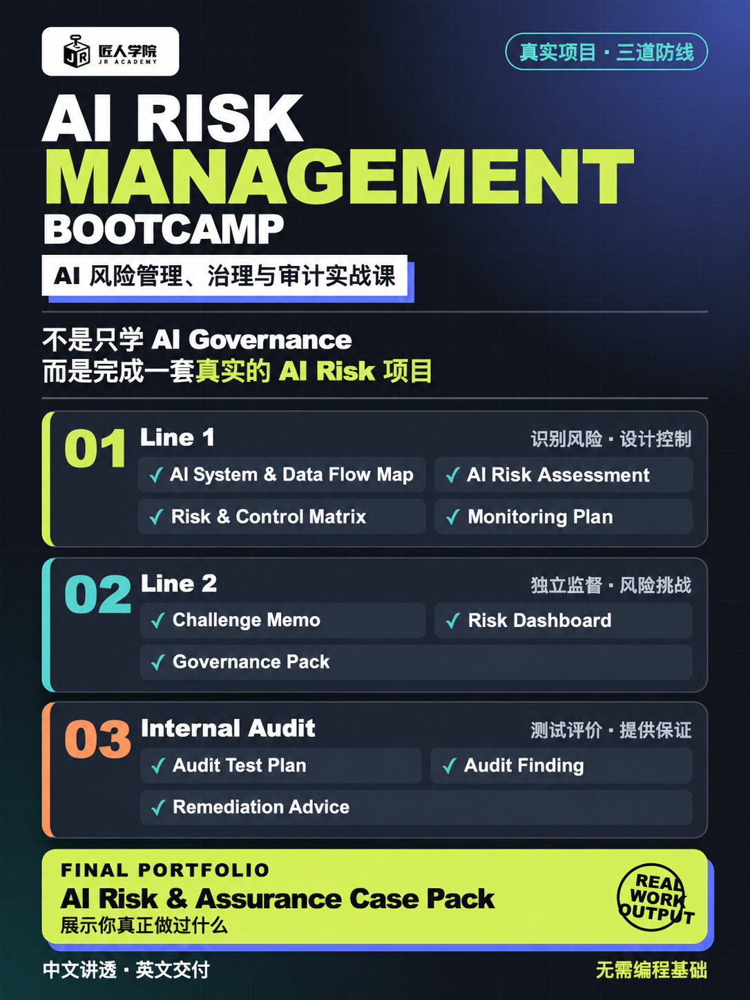

# AI Risk Management Bootcamp 宣传方向

## 使用说明

- 课程：AI Risk Management Bootcamp
- 中文名：AI 风险管理、治理与审计实战课
- 状态：已确认，可用于后续宣传策划、轮播图、长图、落地页及社交媒体内容
- 宣传原则：以职业任务、判断能力和真实交付物为核心，不承诺就业或薪酬
- 时间信息：本组宣传方向不包含具体开课时间、课时或课程时长

## 已确认主海报

文件：[`assets/final-ai-risk-management-poster.png`](assets/final-ai-risk-management-poster.png)

主推广点：

> 不是只学 AI Governance，而是完成一套真实的 AI Risk 项目。

学生围绕银行 GenAI 系统，分别从 Line 1、Line 2 和 Internal Audit 三个角度完成真实工作产物，最终形成 **AI Risk & Assurance Case Pack**。

## 第一屏：制造兴趣

### 主文案

**AI 正在进入企业的每一个流程**

但谁来回答这些问题？

- AI 的结论可靠吗？
- 训练数据有没有偏见？
- 企业数据会不会泄露？
- 模型出错后谁负责？
- 如何留下可以审计的证据？

### 收束句

> **未来的审计对象，不只有流程和系统，还有算法与模型。**

### 传播目的

先让 Audit、Risk、Compliance、GRC 和企业 AI 项目负责人意识到：现有的审计与风险工作对象正在变化，AI Risk 不是泛 AI 趋势，而是已经进入企业流程的专业问题。

## 第二屏：告诉用户能学到什么

不罗列课程章节，使用结果导向表达。

### 主文案

**完成训练营，你将能够：**

- 建立企业 AI 系统清单与风险地图
- 识别幻觉、偏见、隐私和第三方模型风险
- 审查数据质量、模型表现和人工复核机制
- 设计 AI Governance、控制措施与审计程序
- 完成一套可用于工作的 AI Audit Checklist
- 输出专业的 AI 风险评估与审计报告

### 专业依据

AI 审计的典型专业范围包括治理、风险、数据、伦理、模型验证与审计报告。以上表达比泛泛宣传“掌握 AI”更具体，也更符合专业受众的判断方式。

参考资料：[AI Audit Training Overview](https://iectechinc.com/courses/aaia-isaca-advanced-in-ai-audit)

## 第三屏：目标人群

### 主文案

**特别适合：**

- Internal Auditor / IT Auditor
- Risk & Compliance Professionals
- GRC / Cybersecurity 从业者
- Finance、Accounting 与 Assurance 人员
- 希望转向 AI Governance 的咨询顾问
- 正在负责企业 AI 项目的管理人员

### 使用边界

宣传时应强调专业能力迁移，不把所有受众描述为零基础，也不承诺学完即可直接进入高级岗位。

## 第四屏：降低顾虑

### 主文案

**不需要成为算法工程师。**

重点不是训练模型，而是用专业方法判断：

> **它是否可靠、合规、可解释、可追责。**

### 传播目的

降低非工程背景专业人士对技术门槛的顾虑，同时保持课程的专业定位。课程要求学员理解 AI 系统、数据流和模型风险，但不把编程或模型训练设为进入 AI Risk 的前提。

## 推荐四屏顺序

1. 风险问题：AI 进入企业流程后，谁来判断它是否可信？
2. 能力结果：学员最终能够完成哪些专业任务？
3. 人群匹配：哪些已有背景可以迁移进入 AI Risk？
4. 门槛澄清：不需要成为算法工程师，重点是专业判断。

## 合规与表达边界

- 不使用“包就业”“保证转岗”“毕业达到某薪资”等承诺。
- 薪资只能作为公开市场参考，并注明受经验、地区、行业和职级影响。
- 不把课程宣传为认证考试培训，除非未来课程产品正式增加对应内容。
- 不暗示学习者可替代法律、隐私、监管、模型验证或内部审计专业人员的正式责任。
- 海报和轮播优先使用真实工作任务、真实模板和课程案例，不使用未经核实的企业案例或学员结果。
