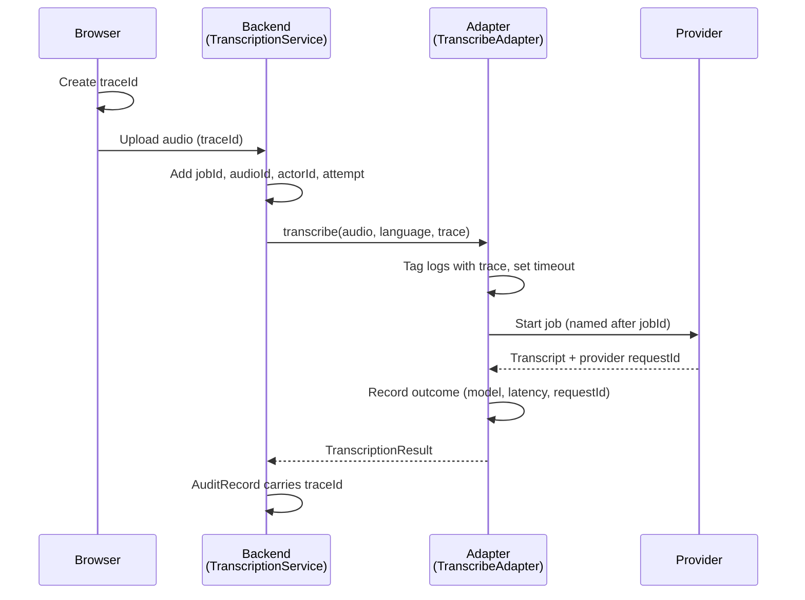
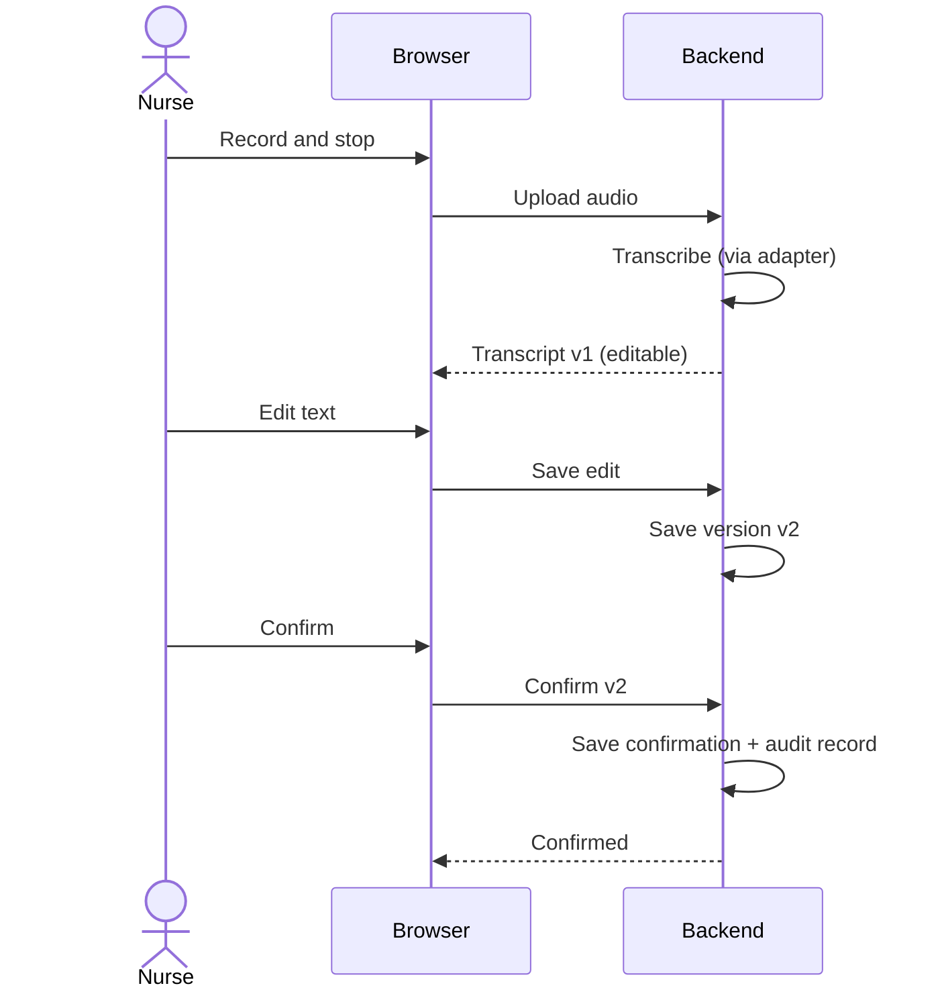

# Prompt — Tutorial 08/11 Slide Deck

Owner: Roy Luo · Status: Draft · Last reviewed: 07/11/2026

> Copy everything below the line into the slide-generation (PPT) agent. It is self-contained: the agent does not need access to this repo or to Notion.

---

## Your task

Create an English slide deck (.pptx, 16:9) for a hands-on coding class. The class continues an existing project called **CareKind** and builds its first AI feature: turning a nurse's voice recording into a **transcript that a human has checked and confirmed**. The teacher codes live with an AI coding assistant (Claude Code or Codex) while the slides explain the flow.

## Audience and tone

- Students who can code but are new to building AI features and to coding agents.
- Simple, plain English. Short bullets (max ~6 per slide, max ~10 words each). One idea per slide.
- Practical, not academic. The slides support live coding; they do not replace it.

## Deck rules

1. **Length:** 18–22 slides.
2. **Every slide** has a title, its content, and **speaker notes** (3–6 sentences the teacher can say). Put the detail in the notes, not on the slide.
3. **Diagrams** are drawn as real slide shapes (boxes, arrows, lifelines), not pasted code. Mermaid source is given below as the exact specification of each diagram — reproduce its boxes, labels and arrows faithfully.
4. **Code** appears only where given below, in a monospace font, at most ~12 lines per slide.
5. **Visual style:** clean and minimal; white or very light background; one accent colour; a consistent diagram style (same box shapes and arrow styles) throughout. No stock photos of patients or clinical settings, no clip art.
6. **Data:** use only invented example data (for example "Resident A", "Room 12"). Never real names, health details or real-looking patient records.
7. **Wording:** never say the product "detects", "predicts", "diagnoses" or "monitors" anything, and never call it "fully automatic". The nurse always reviews and confirms.
8. Do not add content beyond what is given here. If something is unclear, leave a short placeholder `[TBD: …]` rather than inventing it.

## Background the deck should convey

- **CareKind** is a documentation tool for aged care nurses in Australia. Nurses speak their observations; the system turns speech into text that the nurse checks before it becomes part of the record.
- **This class's scope:** voice → confirmed transcript. The confirmed transcript is the trusted input for later features. Raw speech-to-text output is never saved as fact.
- **Out of scope today:** generating progress notes, RAG, autonomous agents inside the product.
- **STT (speech-to-text)** turns audio into words. It is a specialised speech model, **not an LLM**. An LLM (which writes and rewrites text) comes later, to draft notes from confirmed transcripts.

---

## Slide-by-slide content

### Section 0 — Opening

**Slide 1 — Title**
- Title: "CareKind Voice AI: From Recording to Confirmed Transcript"
- Subtitle: "Tutorial · 08/11/2026"

**Slide 2 — Agenda**
1. Feature and requirements run-through
2. Technical design
3. Test strategy
4. Coding agent fundamentals

**Slide 3 — Today's goal and scope**
- Goal: run the project → connect speech-to-text → record → confirmed transcript saved.
- In scope: record, upload, transcribe, human edit and confirm, save, logging.
- Out of scope: progress notes, RAG, product agents.
- Key rule: **AI output is a draft until a human confirms it** (human-in-the-loop, HITL).

### Section 1 — Feature and requirements run-through

**Slide 4 — The feature at a glance**
A left-to-right flow of six steps (draw as a horizontal pipeline):
`Record → Upload → Transcribe → Edit (HITL) → Save → Log`
Speaker notes: walk through each step in one sentence; stress that the nurse is the author of the record.

**Slide 5 — Record and upload**
- Ask for microphone permission; handle "denied".
- Record and stop in the browser.
- Check format and size before upload.
- Upload to the backend; the browser never talks to the speech provider.

**Slide 6 — Transcribe**
- Backend calls one function: `transcribe(audio, language, trace)`.
- Returns text, confidence for each word, provider, exact model, language, latency, request ID.
- Low-confidence words are flagged for the nurse.
- Failures: timeout, unsupported format, empty audio, provider error.

**Slide 7 — Edit and save (human-in-the-loop)**
- Review screen shows side by side: audio playback, raw transcript, editable text.
- Nurse can edit, retry, delete, or type it manually.
- Every edit saves a **new version**; nothing is overwritten.
- Confirming records **who** confirmed **which version** and **when** (audit record).
- Editing a confirmed transcript creates a new version that must be confirmed again.

**Slide 8 — Logging**
Logged at transcription time:
- IDs (trace, job, audio, actor)
- Provider, exact model, language
- Latency, provider request ID, failure type
- Audio duration and size

Callout box: **"Never logged: transcript text, names, filenames."**
Speaker notes: logs are read by many people and tools; health information must never appear in them. Use an allow-list of fields, not a block-list.

**Slide 9 — Where an LLM service fits**
A simple diagram with two boxes side by side:
- Box 1 (highlighted, "Today"): **Speech-to-text service** — audio → words. Specialised speech model.
- Box 2 (greyed, "Next"): **LLM service** — confirmed transcript → draft progress note.
- An arrow from "Confirmed transcript" to Box 2, labelled "only after human confirmation".
Speaker notes: speech-to-text is not an LLM; the LLM service is the next stage and only ever receives confirmed text. The same adapter idea from today applies to the LLM service later.

### Section 2 — Technical design

**Slide 10 — Three-layer architecture**
Three stacked or left-to-right layers:
- **Frontend (browser):** record, upload, review and confirm screen.
- **API (backend):** transcription service, versions, audit, logging. Holds all secrets.
- **External services:** speech-to-text provider (later: LLM provider).
Rules shown as small labels: "Secrets stay in the API layer" · "Frontend never calls external services directly" · "Data processed in Australia".

**Slide 11 — How the trace flows (sequence diagram)**
Draw this sequence diagram exactly:


Speaker notes: the trace is a small object of IDs that travels with one recording, so every log line and audit record can be linked; it never contains transcript text or names. Searching one traceId shows the whole journey.

**Slide 12 — What is a trace?**
Show this code:
```ts
type RequestTrace = {
	traceId: string;    // one ID for the whole recording's journey
	jobId: string;      // the transcription job
	audioId: string;    // the stored audio file
	actorId: string;    // who triggered it (ID only)
	attempt: number;    // 1 = first call, 2 = retry
	deadlineMs: number; // timeout the adapter enforces
};
```
One bullet below: "IDs only — if you wouldn't want it in a log, it isn't in the trace."

**Slide 13 — The adapter pattern**
Diagram: app code → one interface box `SpeechToText` → three adapter boxes below it:
`TranscribeAdapter (cloud provider)` · `WhisperLocalAdapter (runs locally)` · `FakeSpeechToText (tests)`.
Analogy line: "Like a travel power adapter: one plug, many sockets."
Bullets:
- App code depends only on the interface.
- Each adapter translates the provider's API in and out, including errors.
- Swap providers, run offline, or test without changing app code.
Speaker notes: this is the Adapter pattern plus Dependency Inversion (the "D" in SOLID). Only the adapter knows the provider's SDK.

**Slide 14 — The adapter contract**
Show this code:
```ts
interface SpeechToText {
	transcribe(audio: AudioRef, language: LanguageCode,
		trace: RequestTrace): Promise<TranscriptionResult>;
}
// TranscriptionResult: text, words + confidence, provider,
//   model, language, latencyMs, requestId
// Failures: Timeout | UnsupportedFormat | EmptyAudio
//   | ProviderError | Network
```

**Slide 15 — Distributed systems: scaling without losing recordings**
Context line: "Many clinics, many nurses, lots of recordings at once."
Diagram (left to right): `Browsers → API → Audio storage + Job queue → Transcription workers (×N) → Speech-to-text provider`, with a side box `Job store (state per job)`.
Bullets:
- **Store first, process later:** audio is saved before transcription starts.
- **Queue + workers:** add workers to handle more recordings.
- **Idempotency:** the same upload twice creates one job, not two.
- **Retries with backoff;** failed jobs are kept, never dropped.
- **Durable job state:** a crash resumes from the last state.
- **Buffer on the device:** network drop → keep audio locally and retry.
Speaker notes: keep it conceptual — the goal is "no lost recordings" and "scale by adding workers". Today's class code may run this synchronously; the design shows where it grows.

**Slide 16 — Feature design: transcribe + edit (system view)**
High-level system diagram with **only two boxes: Browser and Backend** (the provider is shown as a small external box off the Backend).
- Browser: Record · Upload · Review screen (audio, raw text, editable text) · Confirm.
- Backend: Transcription service · Transcript versions · Confirmation + audit · Logs.
Arrows: "upload audio", "transcript v1", "save edit → new version", "confirm version".

**Slide 17 — Feature design: transcribe + edit (sequence view)**
Draw this sequence diagram (Browser and Backend only):


Small state strip under the diagram: `Idle → Recording → Uploading → Transcribing → Editable → Confirmed` with a note "any step → Failed or Manual entry".

### Section 3 — Test strategy

**Slide 18 — Test strategy**
Three columns:
1. **Happy path (end-to-end):** record → upload → transcribe → confirm. The confirmed version and its audit record exist.
2. **Edge case — empty audio:** send silence or noise; check the system shows "no speech" and **no made-up words**. (Speech models can invent text on silence.)
3. **PII check (manual, through logs):** run a recording with invented names; search the logs; the names and transcript text must not appear.
Footer: "Test data is always synthetic."

### Section 4 — Coding agent fundamentals

**Slide 19 — What is a skill, and why use one?**
- A skill is a reusable instruction file (`SKILL.md`) for one job, e.g. "code review" or "test plan".
- The agent sees only the skill's short description until it needs it, then loads the full steps.
- Why: consistent results, team standards written once, less repeated prompting.
- Harness agnostic: the same skill files work in Claude Code and Codex.

**Slide 20 — Skills vs agents for context management**
Two-column comparison:

| | Skill | Agent (subagent) |
|---|---|---|
| What it is | Instructions loaded into the current conversation | A separate worker with its own context window |
| Context | Shares the main context | Fresh, isolated context; returns a summary |
| Best for | Repeatable how-to steps | Independent work, keeping the main context clean |

Bottom callout — two problems this solves:
- **Context rot:** long conversations get noisy and quality drops → push work into agents.
- **Context bias:** an agent that wrote the code tends to approve it → keep SWE and QA separate, so tests check the requirements, not the implementation.

**Slide 21 — Our agents and their skills**
Three cards side by side:
- **Architect:** solution design (high-level system design) · code design (contracts, classes, sequence diagrams) · code review (against ADRs and confirmed designs)
- **SWE** (does not write tests): coding (follows principles) · PR (with diagrams) · code review (performance, security, quality, unslop)
- **QA:** test plan · test build
Flow arrow beneath the cards: `Architect designs → QA plans tests → SWE codes → QA builds tests → Architect + SWE review`.

**Slide 22 — Wrap-up**
- Today: voice → confirmed transcript, with an adapter, a trace and an audit trail.
- Key ideas: human-in-the-loop · adapter pattern · trace with IDs only · no lost recordings.
- Next: the LLM service turns confirmed transcripts into draft notes.

---

## Output

- One .pptx file, 16:9, titled "CareKind Voice AI — Tutorial 08/11".
- Speaker notes on every slide.
- After generating, list any slide where you used a `[TBD: …]` placeholder.
